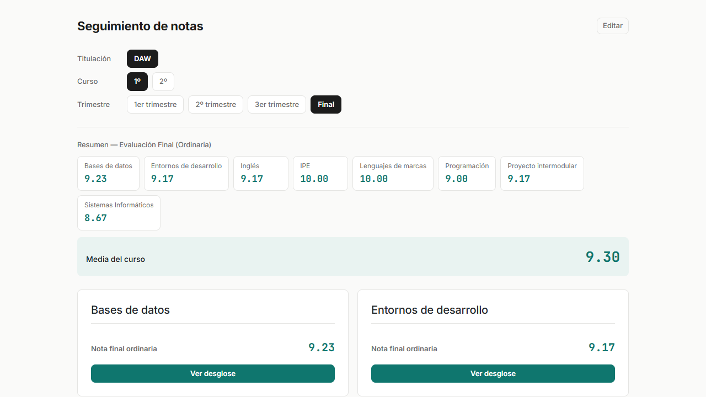
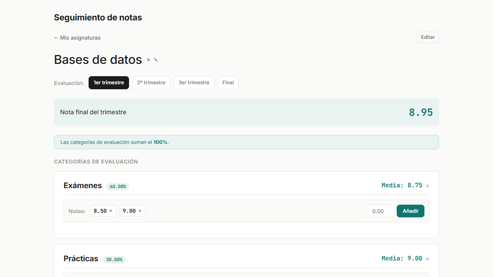
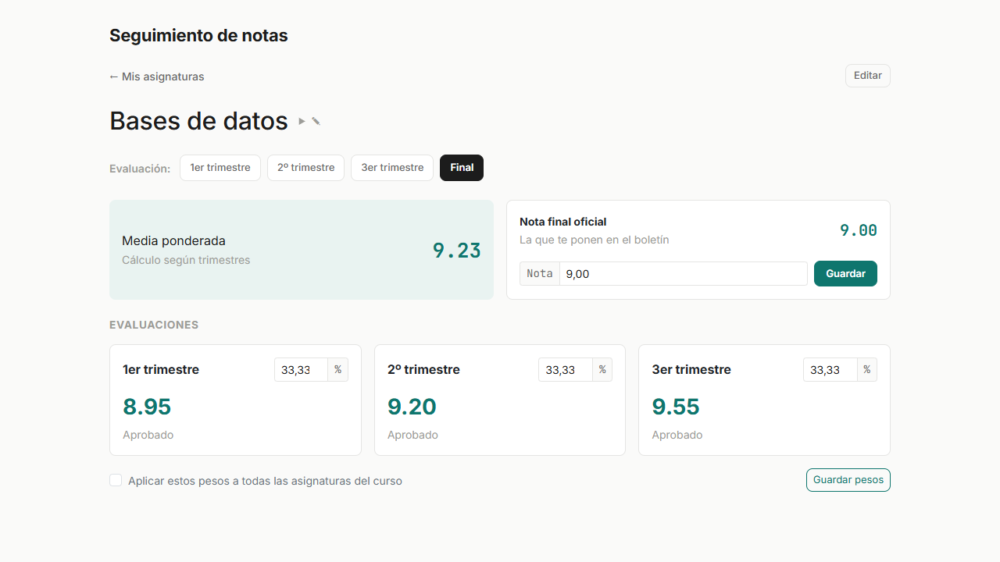
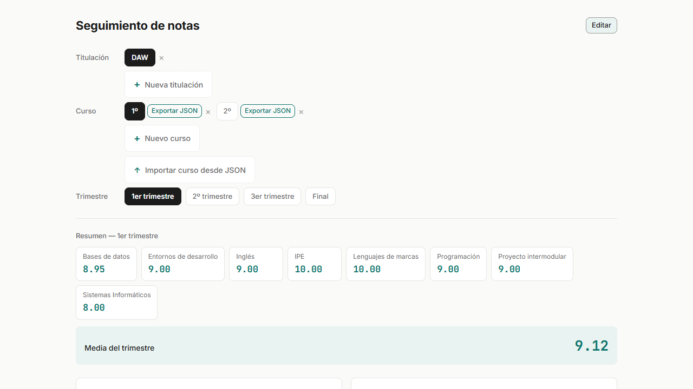
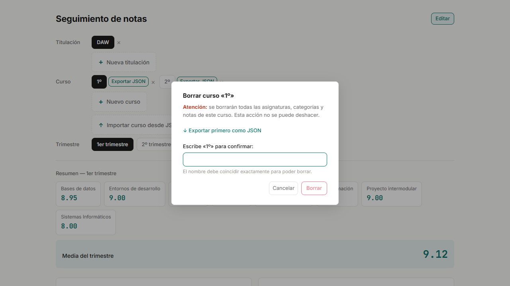
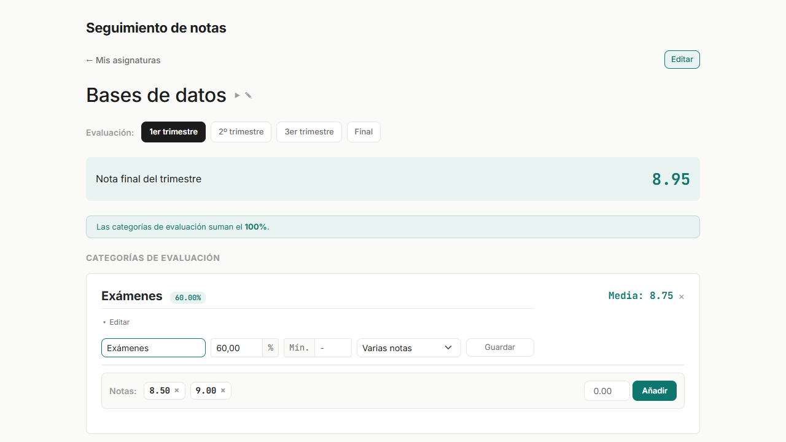
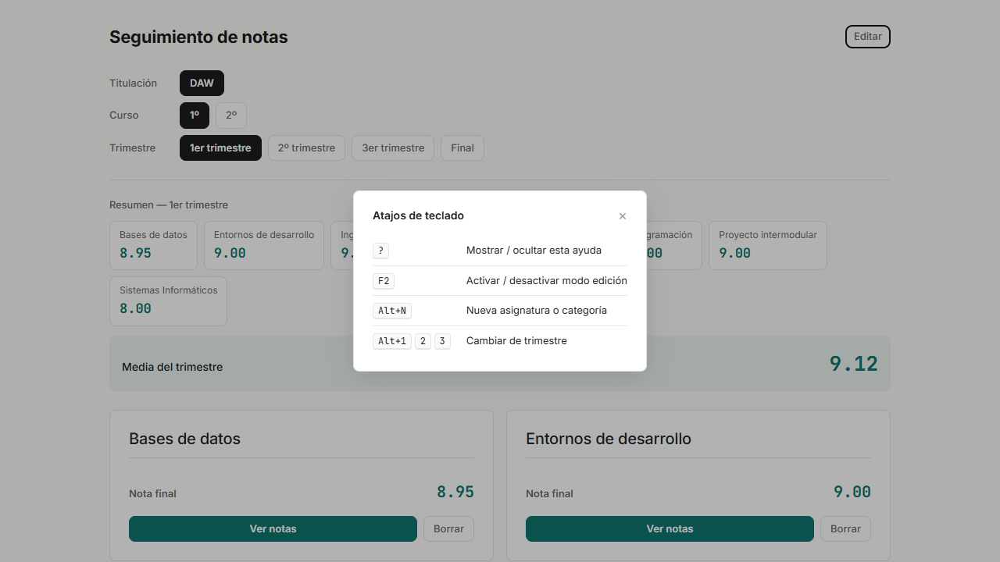
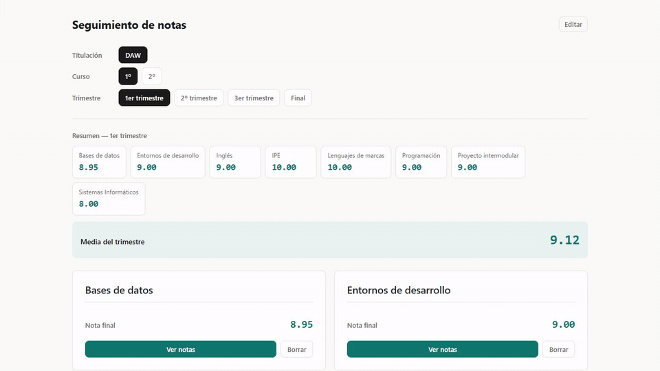

# Calculadora de notas

Aplicación web para llevar el seguimiento de las notas del ciclo (DAW/DAM): titulaciones, cursos, trimestres, asignaturas con categorías de evaluación ponderadas, medias y nota final de curso.

### Resumen por trimestre
Pantalla principal. Eliges titulación, curso y trimestre y ves de un vistazo la nota de cada asignatura y la media del trimestre.

### Resumen final del curso
La pestaña **Final** junta todos los trimestres: calcula la nota final ordinaria de cada asignatura y la media del curso.

### Detalle de asignatura (trimestre)
Cada asignatura se divide en categorías de evaluación con su peso (exámenes, prácticas, actitud...). Las notas se añaden y se borran sin recargar la página y las medias se recalculan al momento.

### Detalle de asignatura (final)
Media ponderada de los trimestres con pesos configurables, y un campo para guardar la nota oficial del boletín y compararla con la calculada.

### Modo edición
El botón **Editar** (o la tecla `F2`) muestra las herramientas de gestión: crear y borrar titulaciones, cursos y asignaturas, exportar un curso a JSON e importarlo después. Fuera de este modo la pantalla queda limpia, solo para consultar.

### Confirmación de borrado
Borrar una titulación o un curso elimina todo lo que contiene, así que hay que escribir su nombre exacto para confirmar. El aviso ofrece exportarlo antes a JSON como copia de seguridad.

### Edición dentro de una asignatura
En el detalle, el modo edición permite cambiar el nombre, el peso, la nota mínima y el tipo de cada categoría (varias notas o nota única). Con la nota mínima, la app avisa si una categoría bloquea el aprobado.

### Atajos de teclado
Pulsando `?` aparece la ayuda con los atajos: modo edición, nueva asignatura o categoría y cambio rápido de trimestre.

### Demostración
Recorrido por la app: cambio de trimestre, nota final del curso y alta de una nota con la media actualizándose en vivo.

